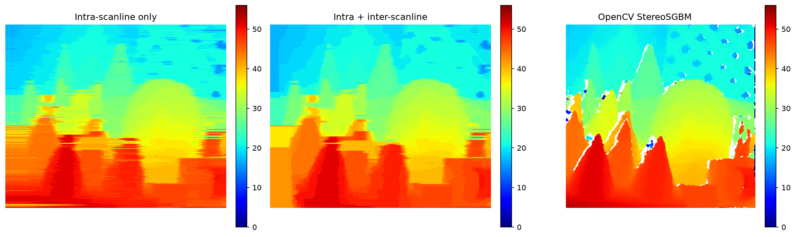
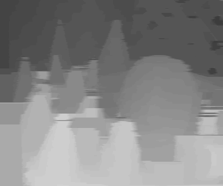
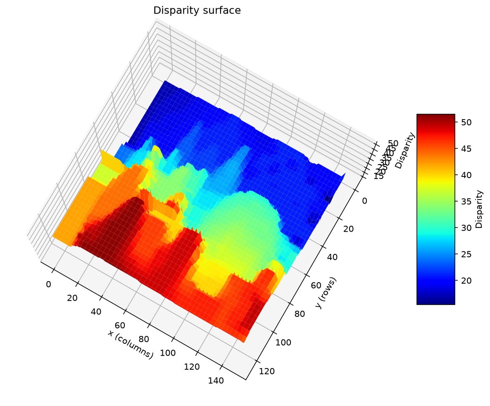
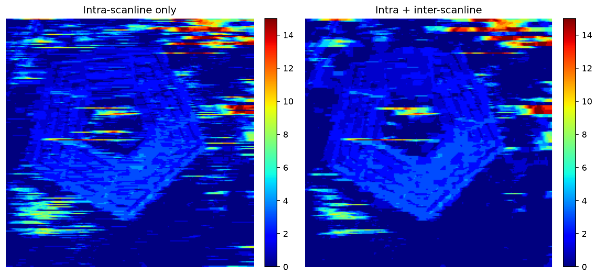

# Stereo Matching with Dynamic Programming (from scratch)

Dense stereo matching implemented from scratch in Python/NumPy, inspired by
**Ohta & Kanade, "Stereo by Intra- and Inter-Scanline Search Using Dynamic Programming"** (IEEE TPAMI, 1985).
Each image row is solved as a shortest-path problem on a graph of `(column, disparity)` nodes, and
the solution of the previous row is used to keep neighbouring rows consistent.
OpenCV's StereoSGBM is included as a baseline.



## How it works

The input is a **rectified** stereo pair: a scene point appears on the same row `y` in both images,
so its match only has to be searched along that row. The left image is the reference, and the
**disparity** `d` of a pixel is the horizontal offset of its match in the right image (closer
objects have larger disparities).

### 1. Matching cost

For each row, every pixel `x` of the left image is compared with pixel `x − d` of the right
image for each disparity `d` in `[0, max_disparity)`:

```
cost(x, d) = | I_L(x, y) − I_R(x − d, y) |
```

Pairs that fall outside the right image (`x < d`) are occluded and get a fixed `occlusion_cost`.
This gives a `width × max_disparity` table: the nodes of the graph for that row.

### 2. Intra-scanline search (dynamic programming)

The disparity profile of the row is the cheapest path from the first to the last column of the
table. Between neighbouring columns the path can keep its disparity or move by one level, which
costs a smoothness penalty `P_h`:

```
C(x, d) = cost(x, d) + min( C(x−1, d),
                            C(x−1, d−1) + P_h,
                            C(x−1, d+1) + P_h )
```

The forward pass stores, for every node, which predecessor was chosen. Backtracking from the
cheapest node of the last column recovers the optimal path, i.e. the disparity of every pixel
of the row.

### 3. Inter-scanline consistency

Solving rows independently creates horizontal streaks, because nothing links a row to its
neighbours. Following Ohta & Kanade's idea of using the vertical neighbourhood, the disparity
chosen on the previous row acts as a prior: any different disparity at the same column costs an
extra `P_v` before the DP runs on the current row. In practice this removes most streaks and
yields coherent regions per object, with no extra run time.

> **Difference from the original paper.** Ohta & Kanade match *edge intervals* and search
> the intra- and inter-scanline problems jointly in a 3D search space. This implementation works
> on *pixels* and propagates the inter-scanline constraint row by row as a penalty, which is
> simpler and keeps the dense, per-pixel output.

## Results

| Cones (Middlebury), `max_disparity=64`, `P_h=25`, `P_v=3` | 3D view |
| :---: | :---: |
|  |  |

Aerial pair (Pentagon), `max_disparity=16`, `P_h=10`:



The DP method produces a dense map with no invalid pixels, while SGBM leaves holes at occlusions
and a band of width `numDisparities` on the left border where no match can be searched. SGBM
gives sharper object boundaries thanks to its multi-directional aggregation.

## Project structure

```
stereo_dp/
  matching.py        # matching cost, inter-scanline penalty, DP forward pass, backtracking
  visualization.py   # epipolar check, side-by-side comparison, 3D surface
notebooks/
  stereo_dp.ipynb    # step-by-step walkthrough of the method, with plots
  sgbm_opencv.ipynb  # OpenCV StereoSGBM baseline and parameter reference
images/              # rectified stereo pairs (Cones, Pentagon)
results/             # generated figures
tests/               # unit tests (pytest)
run_stereo.py        # command-line script
```

## Installation

```bash
git clone https://github.com/henriquecorneau/stereo-method-scratch.git
cd stereo-method-scratch
python -m venv .venv && source .venv/bin/activate
pip install -r requirements.txt
```

## Usage

Command line:

```bash
python run_stereo.py images/cones_left.png images/cones_right.png --max-disparity 64 --sgbm --out results/cones
```

| Option | Default | Description |
| --- | --- | --- |
| `--max-disparity` | 64 | Number of disparity levels searched |
| `--p-h` | 25 | Horizontal smoothness penalty |
| `--p-v` | 3 | Inter-scanline penalty (`0` = rows solved independently) |
| `--occlusion` | 25 | Cost of a pixel without a valid match |
| `--sgbm` | off | Also compute OpenCV StereoSGBM for comparison |
| `--out` | `results` | Output directory |

From Python:

```python
import cv2
from stereo_dp import disparity_dp

left = cv2.imread("images/cones_left.png", cv2.IMREAD_GRAYSCALE)
right = cv2.imread("images/cones_right.png", cv2.IMREAD_GRAYSCALE)
disparity = disparity_dp(left, right, max_disparity=64, p_horizontal=25, p_vertical=3, occlusion_cost=25)
```

The notebooks in `notebooks/` explain each step with intermediate plots
(matching cost table, accumulated cost with the optimal path, effect of the parameters).

## Parameters

* **`P_h`** — larger values give smoother rows but round off thin structures.
* **`P_v`** — larger values propagate the disparity of the previous row more strongly; too large
  and errors propagate downwards.
* **`occlusion_cost`** — how readily a pixel is treated as unmatched.
* **`max_disparity`** — must cover the closest object; larger values are slower (run time is
  linear in `height × width × max_disparity`, about 1.3 s for a 450×375 image with 64 levels).

## Tests

```bash
pip install pytest
python -m pytest tests
```

The tests check the matching cost and penalties, that the DP path never jumps more than one
disparity level, and that a constant synthetic disparity is recovered.

## References

* Y. Ohta and T. Kanade, "Stereo by Intra- and Inter-Scanline Search Using Dynamic Programming,"
  *IEEE Transactions on Pattern Analysis and Machine Intelligence*, vol. PAMI-7, no. 2, pp. 139–154, 1985.
* H. Hirschmüller, "Stereo Processing by Semiglobal Matching and Mutual Information,"
  *IEEE TPAMI*, vol. 30, no. 2, pp. 328–341, 2008 (SGBM baseline).
* D. Scharstein and R. Szeliski, "High-accuracy stereo depth maps using structured light," *CVPR*, 2003
  (Middlebury Cones dataset).
